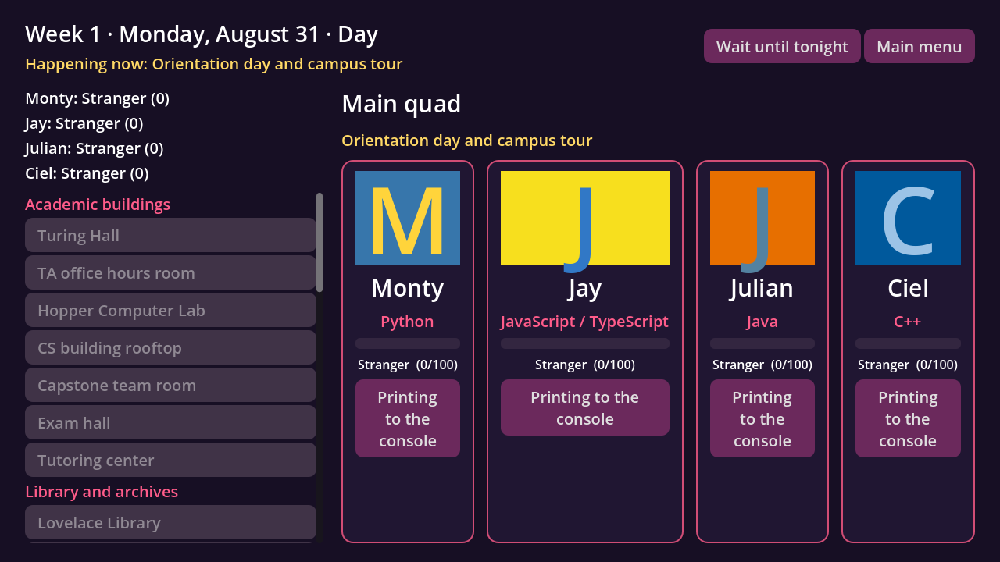

# Commit to Me

A dating sim where you date programming languages. Go on dates with **Python**,
**JavaScript/TypeScript**, **Java** and **C++**, solve little coding challenges
with them, and earn their affection as you learn how each language works.


## Onboarding for devs

Welcome! This section takes you from nothing installed to a running game and
your first pull request. Plan on about an hour the first time.

### What you need

**Accounts**

- A **GitHub account**. Request to be added as collaborator tp
  [the repo](https://github.com/qianyunginawang/commit_to_me)
  (Settings → Collaborators), then accept the email invite.

**Required tools**

| Tool | Why | Mac | Windows |
|---|---|---|---|
| **[GitHub Desktop](https://desktop.github.com/)** | Download the code and share your changes, no command line needed | Download, drag into Applications | Download and run the installer |
| **Godot 4.7** (standard, *not* .NET) | The game engine and editor. Older versions won't work. | [godotengine.org/download](https://godotengine.org/download), drag into Applications | [godotengine.org/download](https://godotengine.org/download), unzip anywhere |

**Languages (for the coding challenges)**

Nothing to install. The game brings its own Python, Node.js (JavaScript and
TypeScript), Java and C++ compiler, and you download them in one step during
[first-time setup](#first-time-setup). The only thing that step needs is
**Python 3.9 or newer** to run the download script:

- **Mac:** run `python3 --version` in Terminal. If it asks to install the
  command line developer tools, say yes; that includes Python.
- **Windows:** install it from [python.org](https://www.python.org/downloads/)
  and tick **"Add python.exe to PATH"** in the installer.

**Nice to have**

- **[VS Code](https://code.visualstudio.com/)** for editing JSON and GDScript
  files. Install the "godot-tools" extension for GDScript highlighting.
- **Command-line Git** if you prefer typing commands to clicking
  (`xcode-select --install` on Mac, [git-scm.com](https://git-scm.com/download/win) on Windows).

### First-time setup

1. **Get the code with GitHub Desktop.**
   1. Open GitHub Desktop and sign in: **GitHub Desktop → Settings → Accounts**
      on Mac, or **File → Options → Accounts** on Windows.
   2. Click **File → Clone Repository**, open the **GitHub.com** tab, and pick
	  `qianyunginawang/commit_to_me`. (If it's not listed, check that you
	  accepted the collaborator invite.)
   3. Choose where to save it, e.g. `Documents/commit_to_me`, and click **Clone**.
2. **Download the game's languages.** In GitHub Desktop, click
   **Repository → Open in Terminal** (Mac) or **Open in Command Prompt**
   (Windows), then run:
   ```sh
   python3 tools/fetch_runtimes.py      # Mac
   python tools/fetch_runtimes.py       # Windows
   ```
   It downloads about 350 MB and unpacks to about 600 MB in the `runtimes/`
   folder, which git ignores, so it never shows up as a change. It takes a few
   minutes and ends with `All set.`
3. **Open it in Godot.** In the Project Manager, click **Import**, choose
   `project.godot` from the folder you just cloned, then **Import & Edit**.
   The first import takes a minute.
4. **Play it.** Press **F5** (**⌘B** on Mac) or the ▶ button in the top right.
   Type a name, pick a character, and try a date through to its coding challenge.
   The very first C++ challenge on your computer takes a minute or two to
   compile while the C++ compiler sets itself up. After that it's quick.
5. **Run the tests** to confirm everything is set up. From the project folder:
   ```sh
   # Mac
   /Applications/Godot.app/Contents/MacOS/Godot --headless --path . -s tests/run_tests.gd
   # Windows (use the path to your Godot .exe)
   Godot_v4.7.1-stable_win64_console.exe --headless --path . -s tests/run_tests.gd
   ```
   It should end with `0 failed`. If you skipped step 2, the code tests use
   whatever languages are installed on your computer and skip the rest.

### How to make a change (with GitHub Desktop)

Every change goes on its own **branch**, then into `main` through a **pull
request** that someone reviews. GitHub Desktop walks you through each step.

1. **Start from the latest code.** At the top of GitHub Desktop, set
   **Current Branch** to `main`, then click **Fetch origin** (it changes to
   **Pull origin** if there's anything new, so click that too). If the pull
   changed `tools/runtimes.json`, run `fetch_runtimes.py` again (step 2 of
   first-time setup). It only downloads what changed.
2. **Make a branch.** Click **Current Branch → New Branch**. Name it after
   you and the change, e.g. `sara/python-date-2`, and create it based on `main`.
3. **Make your change** in Godot or your editor (VSCode). Play it to check it works,
   and run the tests.
4. **Commit.** GitHub Desktop lists every changed file on the left. Click a file
   to see exactly what changed. Untick anything you didn't mean to change.
   Write a short summary at the bottom left (e.g. "Add Monty's second date") and
   click **Commit to sara/python-date-2**. You can commit as often as you like.
5. **Push.** Click **Publish branch** (the first time) or **Push origin** (after
   that) to upload your commits to GitHub.
6. **Open a pull request.** Click **Create Pull Request**. Your browser opens
   on GitHub: write a sentence or two about what you changed and click
   **Create pull request**. The tests run automatically, and someone reviews it
   before it's merged into `main`.
7. **Need to fix something after review?** Stay on the same branch, make the
   fix, commit, and push again. The pull request updates by itself.
8. **After it's merged,** switch back to `main`, click **Pull origin**, and make
   a new branch for your next change.

Good things to know:

- Never commit straight to `main`. If GitHub Desktop warns that you're on
  `main`, make a branch first. It offers to bring your changes with you.
- Godot sometimes adds `uid` lines to `.tscn` files and creates `.uid` files
  next to scripts. That's normal. Commit them.
- Don't commit the `.godot/` folder. It's ignored automatically, so it shouldn't
  appear in the list.
- If GitHub Desktop says there's a **merge conflict**, ask for help before
  clicking anything that discards changes.
- **Repository → Open in Terminal / Show in Finder (Explorer)** jumps straight
  to the project folder, which is handy for running the tests.
- Don't commit anything in `runtimes/` except its README. The downloaded
  languages are ignored automatically.

<details>
<summary>Prefer the command line? The same steps with git commands</summary>

```sh
git checkout main && git pull                  # start from the latest code
git checkout -b ana/python-date-2              # make a branch
# ...make your change...
git add -A && git commit -m "Add Monty's second date"
git push -u origin ana/python-date-2           # then open the PR link git prints
```

</details>

## The Game


| A date | A coding challenge |
|---|---|
|  |  |

## What's here so far

- A main menu, a "who do you want to date?" screen, dates with branching
  dialogue, and a coding-challenge screen with a real code editor.
- One first date per character, each with a coding challenge:
  - **Monty** (Python): f-strings
  - **Jay** (JavaScript/TypeScript): `map()` and arrow functions
  - **Julian** (Java): classes and `main`
  - **Ciel** (C++): `cin` / `cout`
- Affection (0-100) with relationship levels: Stranger, Classmate, Study Buddy,
  Crush, Committed. Progress saves automatically.
- Your code actually runs. Output is checked against the challenge's tests.
- Placeholder art: colored cards with initials until we have real portraits.

### Where to start, depending on what you want to do

| I want to... | Skills needed | Start here |
|---|---|---|
| Write dialogue and dates | Writing, basic JSON | [Adding content](#adding-content-no-coding-needed), then copy `data/dates/python_date_1.json` |
| Design coding lessons | The language you're teaching | `data/challenges/`, plus a working answer in `tests/solutions/` |
| Draw characters or backgrounds | Art (PNG files) | Save portraits as `assets/portraits/<character id>.png` |
| Change screens or gameplay | GDScript (Python-like) | `scripts/ui/` and `scenes/`. Godot's [Getting Started guide](https://docs.godotengine.org/en/stable/getting_started/introduction/index.html) is a good first read. |
| Work on running code | GDScript, how compilers work | `scripts/code_runner/` and [runtimes/README.md](runtimes/README.md) |

## How the project is organized

```
data/                  <- game content, plain JSON. Most writing happens here!
  characters/          one file per dateable language
  dates/               the dialogue for each date
  challenges/          coding exercises used on dates
  languages.json       how to compile/run each language
scenes/                Godot scenes (screens and UI pieces)
scripts/
  autoload/            always-loaded helpers: GameData, GameState, Router
  dialogue/            DialoguePlayer: steps through a date's dialogue
  code_runner/         runs and grades player code
  ui/                  scripts for each screen
assets/                theme, and portraits (assets/portraits/<id>.png)
runtimes/              bundled languages (downloaded, not in git; see its README)
tools/                 fetch_runtimes.py downloads the bundled languages
tests/                 automated tests
```

### How a date works

1. The campus map (`scenes/campus_map.tscn`) shows the week, day and time slot,
   and who is where right now, from the events in `data/calendar.json`.
2. Picking a character at a location opens `scenes/date.tscn` with the next
   lesson they can do there (see `scripts/progress/unlocks.gd`). A date uses up
   the time slot, and "Wait" skips ahead without one.
3. `DialoguePlayer` walks through the date's nodes. A node is either a **line**
   (text, maybe choices) or a **challenge** (opens the code screen).
4. Affection only comes from passing the challenge: +6 the first time you pass
   it, minus 2 for each of Quack's two hints you used (never less than +2).
   The numbers live in `scripts/autoload/game_state.gd`, and the reasoning is in
   `agentcontext/Balance.md`. Dialogue can't change affection.
5. The code screen runs your code through a `CodeRunner` and checks the output
   with `ChallengeGrader`. Passing or failing picks the next dialogue node.

### Adding content (no coding needed)

**A new date:** copy `data/dates/python_date_1.json`, give it a new `id`, write
the dialogue, then add that id to the character's `dates` list.

```json
"hello": {"speaker": "python", "text": "Hi {player}!", "next": "ask"},
"ask": {
  "speaker": "python",
  "text": "Tabs or spaces?",
  "choices": [
	{"text": "Spaces.", "next": "end"},
	{"text": "Tabs.", "next": "end"}
  ]
}
```

- `speaker` is a character id, `"player"`, or `"narrator"`.
- `{player}` is replaced with the player's name.
- `"next": "end"` ends the date.
- `mood` is saved on lines already, ready for when we have expression art.

**A new challenge:** copy a file in `data/challenges/`. Each test gives the
program some input (`stdin`) and says exactly what it should print
(`expected_stdout`). It also needs exactly two `hints`, from a gentle nudge
to nearly the answer. Put a working answer in `tests/solutions/<challenge id>.<ext>`
so the tests can check the challenge is solvable.

**Character art:** save a PNG as `assets/portraits/<character id>.png` and it
replaces the placeholder automatically.

Typos in ids (a date pointing to a node that doesn't exist, etc.) get caught by
the tests and printed as warnings when the game starts.

### The code runner

Everything that runs code goes through one small interface, `CodeRunner`
(`scripts/code_runner/code_runner.gd`), so how code gets run can change without
touching the UI:

- `ProcessCodeRunner` (used now) writes the code into a fresh temp folder,
  compiles it if needed, runs it with a 5 second time limit and an output limit,
  then deletes the folder. It looks for runtimes in `runtimes/<platform>/` first,
  then (only when running from the editor) on your computer.
- `FakeCodeRunner` returns canned answers, for tests and UI work.

The temp folder and limits stop runaway programs; they are not a security
sandbox. That's fine for a single-player game where you run your own code.

## Tests

```sh
godot --headless --path . --import
godot --headless --path . -s tests/run_tests.gd
```

They also run on GitHub for every pull request. More in [tests/README.md](tests/README.md).
