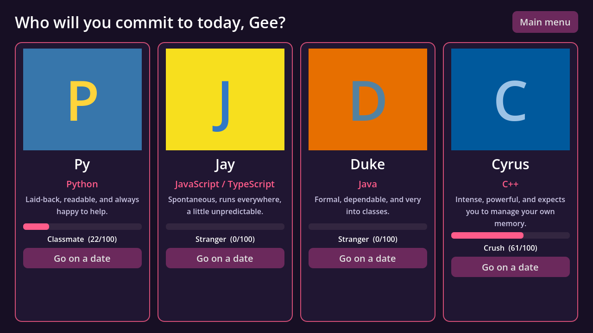
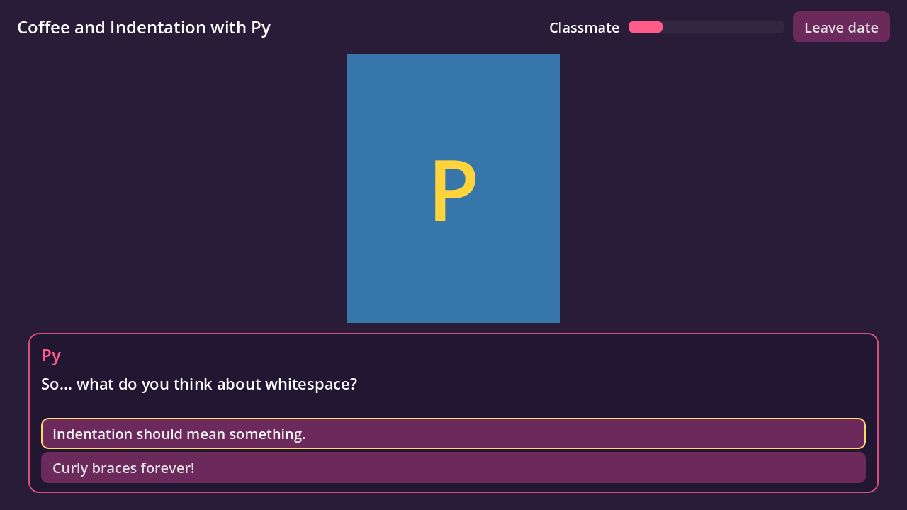
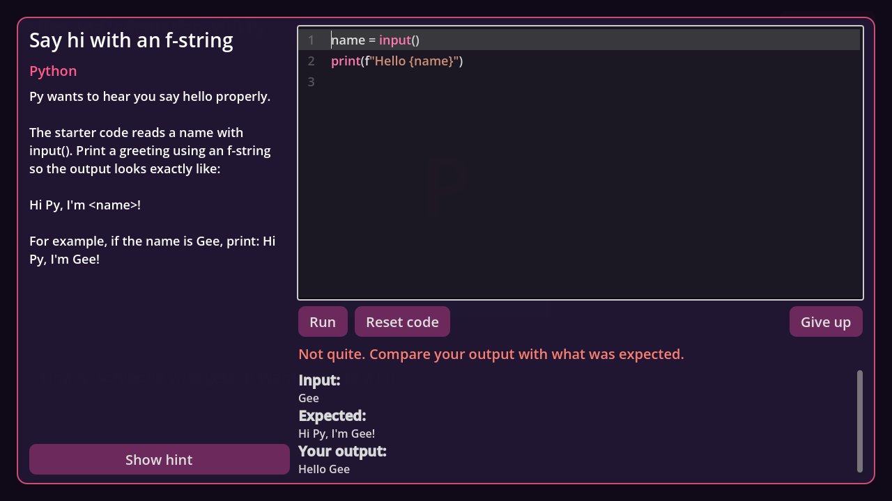

# Commit to Me

A dating sim where you date programming languages. Go on dates with **Python**,
**JavaScript/TypeScript**, **Java** and **C++**, solve little coding challenges
with them, and earn their affection as you learn how each language works.



| A date | A coding challenge |
|---|---|
|  |  |

## What's here so far

- A main menu, a "who do you want to date?" screen, dates with branching
  dialogue, and a coding-challenge screen with a real code editor.
- One first date per character, each with a coding challenge:
  - **Py** (Python): f-strings
  - **Jay** (JavaScript/TypeScript): `map()` and arrow functions
  - **Duke** (Java): classes and `main`
  - **Cyrus** (C++): `cin` / `cout`
- Affection (0-100) with relationship levels: Stranger, Classmate, Study Buddy,
  Crush, Committed. Progress saves automatically.
- Your code actually runs. Output is checked against the challenge's tests.
- Placeholder art: colored cards with initials until we have real portraits.

## Getting started

1. Install **[Godot 4.7](https://godotengine.org/download)** (the standard
   version, not .NET).
2. Clone the repo:
   ```sh
   git clone https://github.com/qianyunginawang/commit_to_me.git
   ```
3. Open Godot, click **Import**, and pick the `project.godot` file in the repo.
4. Press **F5** (or the ▶ button, top right) to play.

### Running the coding challenges while developing

When you play from the editor, the game uses the languages installed on your
computer. Install whichever ones you want to test:

| Language | Command the game looks for | Mac | Windows |
|---|---|---|---|
| Python | `python3` | `brew install python` | [python.org](https://www.python.org/downloads/) (tick "Add to PATH") |
| JS / TS | `node` (v22.6+ for TypeScript) | `brew install node` | [nodejs.org](https://nodejs.org/) |
| Java | `javac` and `java` | `brew install openjdk` | [Adoptium JDK](https://adoptium.net/) |
| C++ | `g++` | `xcode-select --install` | [WinLibs MinGW](https://winlibs.com/) |

If one is missing, the challenge screen tells you instead of crashing.

The finished game will **bundle** these with the download so players don't need
to install anything. That isn't set up yet: see [runtimes/README.md](runtimes/README.md).

## How the project is organized

```
data/                  <- game content, plain JSON. Most writing happens here!
  characters/          one file per dateable language
  dates/               the dialogue for each date
  challenges/          coding exercises used on dates
  languages.json       how to compile/run each language
scenes/                Godot scenes (screens and UI pieces)
scripts/
  autoload/            always-loaded helpers: GameData, GameState, Router
  dialogue/            DialoguePlayer: steps through a date's dialogue
  code_runner/         runs and grades player code
  ui/                  scripts for each screen
assets/                theme, and portraits (assets/portraits/<id>.png)
runtimes/              bundled languages go here (not in git, see its README)
tests/                 automated tests
```

### How a date works

1. The hub lists characters from `data/characters/`. Each one has a list of `dates`.
2. Picking a character opens `scenes/date.tscn` with their next date from `data/dates/`.
3. `DialoguePlayer` walks through the date's nodes. A node is either a **line**
   (text, maybe choices) or a **challenge** (opens the code screen).
4. Lines and choices can have `"affection": 5` (or negative!) to change how
   much that character likes you.
5. The code screen runs your code through a `CodeRunner` and checks the output
   with `ChallengeGrader`. Passing or failing picks the next dialogue node.

### Adding content (no coding needed)

**A new date:** copy `data/dates/python_date_1.json`, give it a new `id`, write
the dialogue, then add that id to the character's `dates` list.

```json
"hello": {"speaker": "python", "text": "Hi {player}!", "next": "ask"},
"ask": {
  "speaker": "python",
  "text": "Tabs or spaces?",
  "choices": [
    {"text": "Spaces.", "affection": 5, "next": "end"},
    {"text": "Tabs.", "affection": -5, "next": "end"}
  ]
}
```

- `speaker` is a character id, `"player"`, or `"narrator"`.
- `{player}` is replaced with the player's name.
- `"next": "end"` ends the date.
- `mood` is saved on lines already, ready for when we have expression art.

**A new challenge:** copy a file in `data/challenges/`. Each test gives the
program some input (`stdin`) and says exactly what it should print
(`expected_stdout`). Put a working answer in `tests/solutions/<challenge id>.<ext>`
so the tests can check the challenge is solvable.

**Character art:** save a PNG as `assets/portraits/<character id>.png` and it
replaces the placeholder automatically.

Typos in ids (a date pointing to a node that doesn't exist, etc.) get caught by
the tests and printed as warnings when the game starts.

### The code runner

Everything that runs code goes through one small interface, `CodeRunner`
(`scripts/code_runner/code_runner.gd`), so how code gets run can change without
touching the UI:

- `ProcessCodeRunner` (used now) writes the code into a fresh temp folder,
  compiles it if needed, runs it with a 5 second time limit and an output limit,
  then deletes the folder. It looks for runtimes in `runtimes/<platform>/` first,
  then (only when running from the editor) on your computer.
- `FakeCodeRunner` returns canned answers, for tests and UI work.

The temp folder and limits stop runaway programs; they are not a security
sandbox. That's fine for a single-player game where you run your own code.

## Tests

```sh
godot --headless --path . --import
godot --headless --path . -s tests/run_tests.gd
```

They also run on GitHub for every pull request. More in [tests/README.md](tests/README.md).

## Working together

- Make a branch for your change, push it, and open a pull request.
- Godot can show "uid" changes in `.tscn` files after you open the project.
  That's normal; commit them.
- Commit the `.uid` files next to scripts too. Godot uses them to keep track of files.

## Ideas / next steps

- Real character art and expressions (`mood`)
- More dates per character, covering more language features
- Bundling the runtimes (see [runtimes/README.md](runtimes/README.md))
- Music and sound effects
- Endings when a character reaches "Committed"
